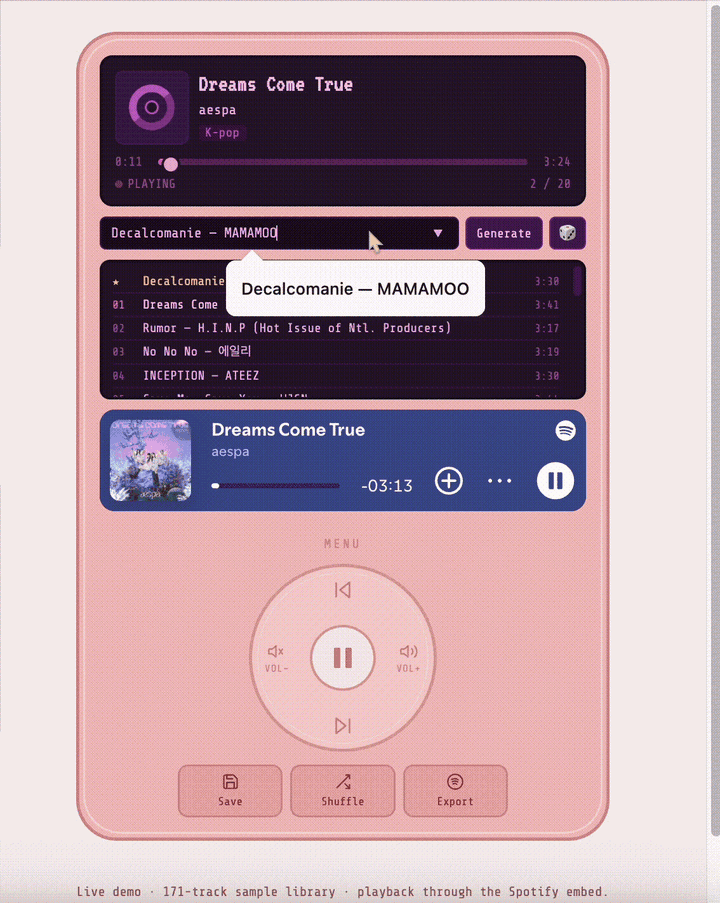
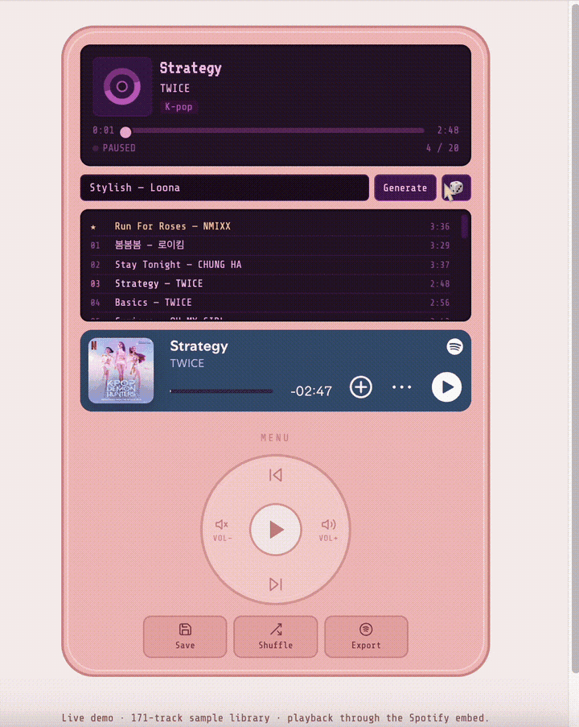
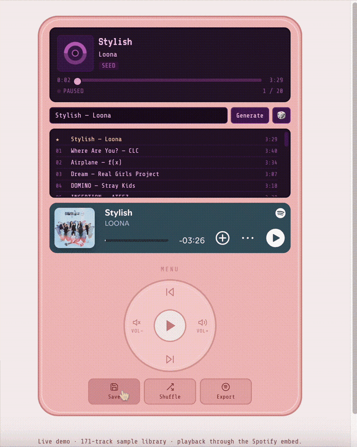
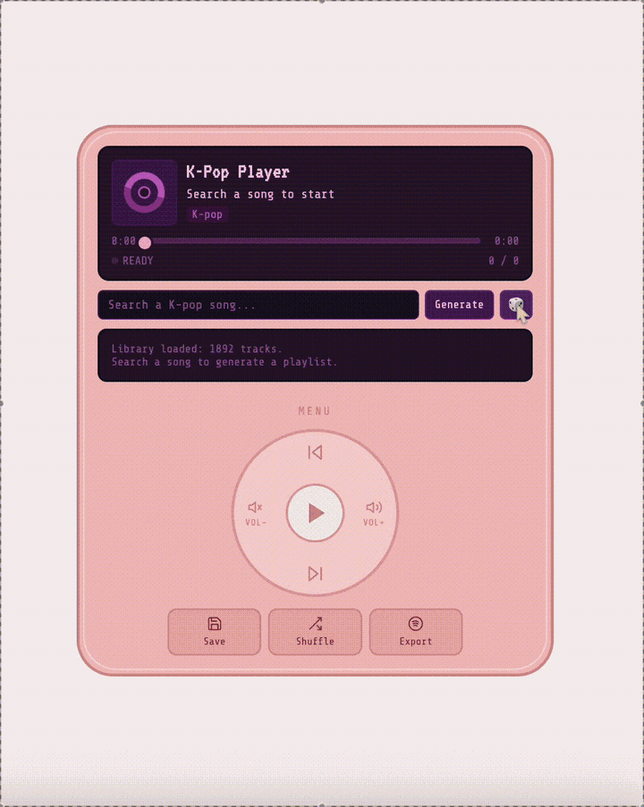
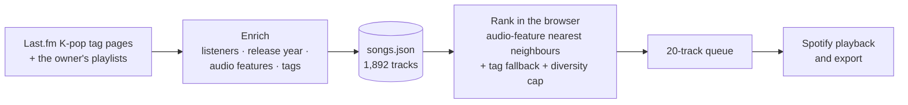

# K-pop Cold-Start Player

A retro MP3-player web app that turns one K-pop song into a 20-track queue —
built for the long tail, where there are no listening logs to learn from and
most tracks carry little or no metadata.

**[▶ Try the live demo](https://snuuym.github.io/kpop-rec/)** — no login, no install.

<p align="center">
  
</p>

## Try it

1. Open the [demo](https://snuuym.github.io/kpop-rec/).
2. Pick a song from the search list, or press 🎲 for a random one.
3. The queue fills with 19 recommendations and starts playing. Skip with the
   wheel, click any track to jump to it, or press **Shuffle** for a new draw.

The demo runs on a 171-track sample and plays through the Spotify embed:
30-second previews, or whole tracks if you are logged in to Spotify in the same
browser. The full app also searches any song, not just the sample, and exports
the queue to your Spotify account — see [Run it locally](#run-it-locally).

## Features

- **One seed, one queue.** Search a song and get 20 tracks that sound like it,
  ranked by audio features, with genre tags as the fallback.
- **Roll the dice.** 🎲 picks a random seed and starts playing straight away.
- **Plays in the page.** Through the Spotify Web Playback SDK when you connect
  Spotify, or through the Spotify embed with no credentials at all — driven by
  the player's own wheel either way.
- **Saved playlists.** Save, rename, reload and delete queues under **MENU**;
  they live in the browser.
- **Export to Spotify.** One button turns the queue into a real Spotify
  playlist.
- **A library that grows.** Searching a song the library does not have adds it,
  so the next search can recommend it.

<table>
  <tr>
    <th>🎲 Random seed</th>
    <th>Saved playlists</th>
    <th>Export to Spotify</th>
  </tr>
  <tr>
    <td></td>
    <td></td>
    <td></td>
  </tr>
</table>

## How it works



A Python pipeline builds the library: tracks and tags from Last.fm, release
years from MusicBrainz, and nine acoustic features per track from ReccoBeats
(Spotify retired its own audio-features endpoint in November 2024). The
ranking itself runs entirely in the browser. For a seed with audio features it
takes the nearest neighbours under a weighted distance — mood and energy count
most, production traits less — adds a small bonus for shared genres, and caps
how many tracks one genre can take so the queue does not collapse into a
single sound. A seed with no features falls back to tag overlap.

## Engineering highlights

- **Found and worked around a silent upstream failure.** Last.fm's
  `track.getTopTags` returns an empty list — HTTP 200, valid JSON — for many
  tracks whose pages show tags, and it fails more often for obscure ones.
  Falling back to album-level tags lifts the share of tracks with a usable tag
  the pipeline can retrieve from 22.6% to at least 73.5%. The write-up is in the [analysis](docs/ANALYSIS.md#the-first-headline-was-an-artefact).
- **Every published number is checked twice.** The analysis is computed in
  pandas and recomputed independently in SQLite; `make sqlcheck-full` compares
  418 numbers and fails on any disagreement.
- **Benchmarked against the baseline that matters.** Five ranking policies are
  scored against a popularity baseline and a random floor, by popularity
  quintile. The queue length of 20 came out of that measurement: it keeps a 43%
  chance of a hit at 1.61× the precision of random.
- **No credentials in the page.** Keys are read from the environment and served
  by a local server bound to 127.0.0.1; Spotify login uses PKCE, so no client
  secret ever reaches the browser. The static demo build fails if anything
  key-shaped appears in the page.
- **Safe writes.** The one endpoint that writes the library whitelists and
  length-caps every field, de-duplicates, backs up and writes atomically.
- **211 tests**, no network or credentials needed.

## The analysis behind it

The player came first; the harder question was whether content-based ranking
helps where it is supposed to — on tracks almost nobody has listened to. The
benchmark's answer so far is mixed and stated plainly: at K=10 no content-based
policy beats ranking by raw popularity on average, but popularity falls below
random for the coldest tracks, and audio features are the only signal that
stays above the floor there. Along the way, the tag data turned out to be
partly an artefact of the failing API above, which overturned the project's
first headline finding.

Human relevance judgements for the coldest tracks are being collected, so the
cold-end conclusions are provisional. **Full write-up: [docs/ANALYSIS.md](docs/ANALYSIS.md).**

## Run it locally

```bash
git clone https://github.com/snuuym/kpop-rec.git
cd kpop-rec
make install
make app        # http://127.0.0.1:5000
```

A fresh clone runs on the bundled 200-track sample. Credentials unlock more,
one feature each:

| Set in the environment | Unlocks |
|---|---|
| nothing | library search, recommendations, preview playback, saved playlists |
| `LASTFM_API_KEY` | search any song; songs not in the library are added to it |
| `SPOTIFY_CLIENT_ID` | full-track playback in the page and export to Spotify (needs Spotify Premium) |

For the Spotify features, use a client ID from your own app: create one in the
[Spotify developer dashboard](https://developer.spotify.com/dashboard), tick
*Web API* and *Web Playback SDK*, and add
`http://127.0.0.1:5000/kpop-mp3-player.html` as its redirect URI. A new app is
in development mode, which lets its owner log in straight away.

Copy `.env.example` to `.env`, fill it in, and `set -a && source .env && set +a`.
To rebuild the full 1,892-track library (about 40 minutes, resumable):
`make all`. To rebuild the static demo: `make demo`, then `make demo-serve`.

## Project layout

```
app/          the player: one HTML file, no build step, plus a small Flask server
src/kpoprec/  shared library: taxonomy, normalization, Last.fm client, ranking, metrics
scripts/      pipeline stages, the benchmark, the SQL cross-check, the demo build
sql/          SQLite schema and one query per published number
docs/         the live demo (GitHub Pages) and the analysis write-up
data/         the 200-track sample (the full library is not redistributed)
reports/      generated analysis and benchmark reports
tests/        211 tests
```

## Tech stack

Python (requests, pandas, numpy, matplotlib, Flask) · vanilla JavaScript, no
framework or bundler · Spotify Web Playback SDK and iFrame API ·
[Last.fm](https://www.last.fm/api) · [ReccoBeats](https://reccobeats.com/) ·
[MusicBrainz](https://musicbrainz.org/) · SQLite · GitHub Pages

## License

MIT — see [LICENSE](LICENSE). The code is MIT; the underlying track metadata
belongs to Last.fm and its contributors, which is why this repository ships a
sample rather than the full dataset.
